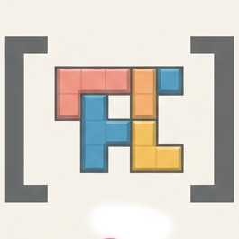
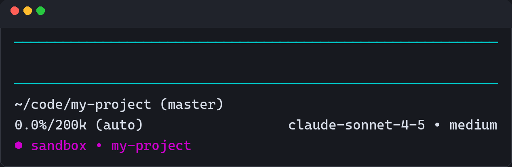

<p align="center">
  
</p>

<h1 align="center">pi-sandbox</h1>

<p align="center"><em>Containerized Pi coding-agent harness.</em></p>

<!-- markdownlint-disable MD013 -->
<p align="center">
  <a href="https://github.com/elmuz/pi-sandbox/actions/workflows/ci.yml"></a>
  <a href="https://www.shellcheck.net/"></a>
  <a href="https://github.com/hadolint/hadolint"></a>
  <a href="https://yamllint.readthedocs.io/"></a>
  <a href="https://github.com/DavidAnson/markdownlint"></a>
  <a href="LICENSE"></a>
</p>
<!-- markdownlint-enable MD013 -->

A rootless Podman sandbox for the
[Pi coding agent](https://github.com/earendil-works/pi-coding-agent).

Pi runs in a disposable rootless Podman container. By default it has no access
to the host checkout: workspace mounts (`ro` or `rw`), public egress, clipboard,
tokens and signing are explicit opt-ins. Sessions and provider auth are
intentionally bridged into the container, while the host home, SSH keys,
Podman socket and namespaces stay outside.

Runtime state lives under `${XDG_DATA_HOME:-$HOME/.local/share}/pi-sandbox`
unless `PI_SANDBOX_STATE` overrides it.

<p align="center">
  
</p>

<p align="center"><em>The container-only footer row marks the sandbox and
shows the current project.</em></p>

## Features

- Workspace exposure is opt-in: `none` by default, `ro` for read-only analysis,
  `rw` for editing. A disposable scratch mode covers `$HOME` and `/`.
- Rootless Podman with `userns=keep-id`, a read-only root filesystem,
  `cap-drop=ALL`, `no-new-privileges`, CPU/memory/PID/file-descriptor limits.
- No direct internet or LAN route. A shared egress proxy denies every
  destination by default and requires host-owned allow rules for the model
  provider or package and git endpoints.
- Per-project sessions and state, with per-session auth seeded read-only from
  the host and discarded on exit.
- Opt-in GitHub CLI access, Git identity and OpenPGP signing through the host
  `gpg-agent`.
- Opt-in Wayland clipboard access for pasting images into Pi.
- Optional MCP client access to server-mcp over an internal network.

## Default posture

A fresh install is deliberately inert:

- **No model access.** Egress denies every destination, including the model
  provider. Pi cannot answer a prompt until you allow an endpoint.
- **No project files.** The host workspace is not mounted. Pi starts in an
  empty, disposable `/workspace`.
- **No extra capabilities.** Clipboard, GitHub token, host GPG signing and MCP
  are all disabled.

This is secure by construction, but it is not a working coding agent yet. Every
capability is a door that you must open deliberately. The launcher prints a
summary of the non-default capabilities at startup; set `PI_SANDBOX_WARN=0` to
silence that summary and the workspace secret warning.

## Quick start

Requires rootless Podman and a host Pi installation.

### 1. Install

```bash
git clone git@github.com:elmuz/pi-sandbox.git
cd pi-sandbox
./install.sh
```

### 2. Allow your model provider (required)

Egress denies everything by default. Add only the endpoint you actually use,
then restart the proxy:

```bash
printf 'allow openrouter.ai 443\n' \
  >> "$HOME/.config/pi-sandbox/egress-policy.conf"
pi-sandbox --restart-egress
```

Replace `openrouter.ai` with `api.openai.com`, `api.anthropic.com`, or whatever
provider you use. Add package/git endpoints later only if the agent needs them.

### 3. Choose how to expose your project

For a normal coding session, mount the checkout read-write:

```bash
cd ~/code/some-project
pi-sandbox --workspace-mode rw
```

To keep it read-only while inspecting code:

```bash
pi-sandbox --workspace-mode ro
```

To keep it completely unmounted:

```bash
pi-sandbox
```

Be aware of the trade-off: `rw` lets the agent write files that a host-side
git, test, build, deploy or IDE process may execute later. `ro` still exposes
repository contents to the model provider and egress. `none` is the most
isolated. Set `PI_SANDBOX_WORKSPACE_MODE=rw` in
`~/.config/pi-sandbox/config` to make your choice persistent.

### 4. Reuse the host Pi login

```bash
install -m 0600 ~/.pi/agent/auth.json \
  "$HOME/.local/share/pi-sandbox/auth/auth.json"
```

The container copies that file into a per-session tmpfs. Login and refresh
writes are discarded on exit, so the host file is never modified.

## Optional capabilities

Add these to `~/.config/pi-sandbox/config` only if you need them:

```bash
# Wayland clipboard: lets Pi read clipboard images (and clipboard data).
PI_SANDBOX_CLIPBOARD=1

# GitHub CLI: uses the token file below as GH_TOKEN.
PI_SANDBOX_GH_TOKEN=1

# Host GPG signing: forwards the host gpg-agent extra socket.
PI_SANDBOX_GPG_SIGN=1

# Silence the startup capability summary and secret warning.
PI_SANDBOX_WARN=0
```

Egress remains deny-by-default even after these are enabled. Add explicit
`allow` rules for anything else the agent must reach. See
[capability defaults](docs/security.md#capability-defaults) for the full list
and the risks behind each switch.

Rebuild both images after a Pi update with `pi-sandbox --update`.

## Documentation

The [documentation index](docs/index.md) links to every guide.

| Guide | What it covers |
| --- | --- |
| [Getting started](docs/getting-started.md) | Install, image build, first run and updates |
| [Usage](docs/usage.md) | Workspaces, sessions, global config, footer and clipboard |
| [Security](docs/security.md) | Container model, mounts, credentials, Git and GPG |
| [Egress](docs/egress.md) | Proxy model, policy syntax, lifecycle and verification |
| [MCP integration](docs/mcp.md) | server-mcp contract, tokens, Compose and troubleshooting |
| [Development](docs/development.md) | Repository layout, CI, lint rules and self-tests |

## License

Released under the [MIT License](LICENSE).
